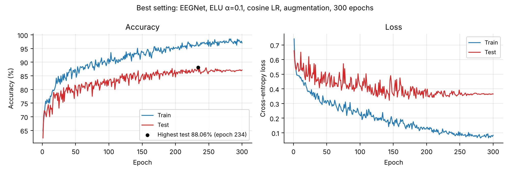
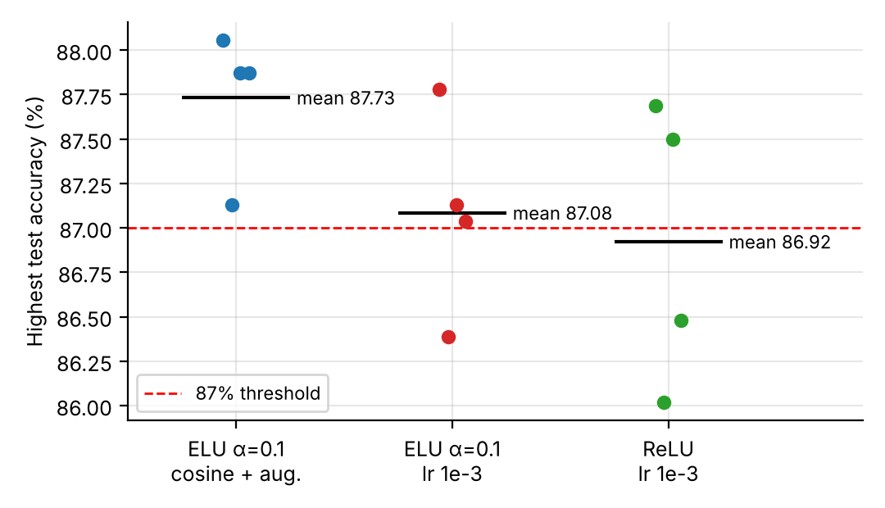

# Lab 2 : EEG classification with EEGNet

## Goal

Classify two-class motor-imagery EEG (left vs. right hand) from **BCI Competition III – IIIb** (subjects S4 and X11, 2 bipolar channels, 750 samples per trial) with **EEGNet**, implemented from scratch in PyTorch. **DeepConvNet** is implemented for the bonus. The experiments compare activation functions, ELU α, dropout, learning-rate schedules, a true depthwise-separable convolution, data augmentation, and random seeds.

**Highest testing accuracy: 88.06%** (EEGNet, ELU α = 0.1, cosine LR, data augmentation, 300 epochs, epoch 234).



## Run in Google Colab

1. Choose a GPU runtime.
2. Upload this `lab2` folder, and put `S4b_train.npz`, `X11b_train.npz`, `S4b_test.npz` and `X11b_test.npz` in `lab2/data/`. The dataset is provided with the assignment and is not committed here.
3. Run:

   ```python
   %cd /content/lab2
   !python main.py                      # baseline EEGNet from the spec
   !python main.py -activation elu -alpha 0.1 -num_epochs 300 -cosine \
                   -aug_shift 25 -aug_scale 0.1 -aug_noise 0.05 -seed 0   # best setting
   !python run_experiments.py           # all round-1 experiments (incl. DeepConvNet)
   !python tune.py                      # round-2 search + extra seeds
   !python plot_report_figures.py       # figures used in the report
   ```

Each run prints the per-epoch train/test loss and accuracy and ends with `Highest testing accuracy: xx.xx% at epoch N`. It writes `results/<name>.json` (config + full history), curve plots in `figures/`, and the best-epoch weights in `weights/`.

Requires PyTorch, NumPy, Matplotlib and tqdm (all pre-installed in Colab).

## Model

| Block | Layers | Output |
| --- | --- | --- |
| firstconv | Conv2d(1→16, (1,51), pad (0,25)) + BN | 16 × 2 × 750 |
| depthwiseConv | Conv2d(16→32, (2,1), groups=16) + BN + ELU + AvgPool(1,4) + Dropout | 32 × 1 × 187 |
| separableConv | Conv2d(32→32, (1,15), pad (0,7)) + BN + ELU + AvgPool(1,8) + Dropout | 32 × 1 × 23 |
| classify | Linear(736→2) | 2 logits |

17,874 parameters. `nn.CrossEntropyLoss` is used, with no softmax after the last layer. DeepConvNet (150,977 parameters) follows the table in the spec with C = 2, T = 750, N = 2, without max-norm.

## Command-line options (`main.py`)

| Option | Meaning | Default |
| --- | --- | --- |
| `-model {eegnet,deepconvnet}` | network | eegnet |
| `-activation {elu,relu,leakyrelu}`, `-alpha` | activation / ELU α | elu, 1.0 |
| `-dropout` | dropout rate | 0.25 |
| `-lr`, `-weight_decay`, `-optimizer {adam,adamw}`, `-cosine` | optimisation | 1e-2, 1e-3, adam, off |
| `-num_epochs`, `-batch_size`, `-seed` | training | 150, 64, 0 |
| `-F1`, `-D`, `-F2`, `-true_separable` | EEGNet width / true depthwise-separable conv | 16, 2, 32, off |
| `-label_smoothing` | label smoothing | 0 |
| `-aug_shift`, `-aug_scale`, `-aug_noise` | random time shift (samples), amplitude scaling, Gaussian noise (training only) | 0 |

## Results

Round 1: settings from the spec (150 epochs, seed 0). "Mean last 10" is the mean testing accuracy of the last 10 epochs.

| Setting | Highest test | Mean last 10 |
| --- | ---: | ---: |
| Baseline (ELU α=1.0, dropout 0.25, lr 1e-2) | 81.57% | 79.04% |
| ReLU | 86.11% | 83.81% |
| LeakyReLU | 83.70% | 81.85% |
| ELU α=0.1 / 0.5 / 1.5 | 86.48% / 83.52% / 76.67% | 83.94% / 81.16% / 75.24% |
| Dropout 0.1 / 0.5 | 81.20% / 75.00% | 78.10% / 72.20% |
| lr 1e-3 / lr 1e-2 + cosine | 81.85% / 82.31% | 80.13% / 81.24% |
| True depthwise-separable conv | 79.91% | 78.89% |
| DeepConvNet ELU / ReLU / LeakyReLU | 80.37% / 82.04% / 81.94% | 77.60% / 79.67% / 79.17% |

Round 2: 300 epochs (`tune.py`). The best setting is ELU α=0.1 + cosine LR + augmentation. It reached **88.06%** (seed 0) and stayed above 87% for all four seeds (88.06 / 87.13 / 87.87 / 87.87, mean 87.73%). All 34 runs are listed in [`results/summary.csv`](results/summary.csv).



The highest testing accuracy is chosen on the test set, as the lab requires, so it is optimistic. The mean of the last 10 epochs (86.99% for the best setting) is a fairer estimate.

## Files

- [`main.py`](main.py): training / testing loop, plotting, and all command-line options.
- [`models/EEGNet.py`](models/EEGNet.py): EEGNet and DeepConvNet.
- [`dataloader.py`](dataloader.py): loads the `.npz` files and returns arrays of shape `[N, 1, 2, 750]` with labels {0, 1}.
- [`run_experiments.py`](run_experiments.py): round-1 experiments and comparison plots.
- [`tune.py`](tune.py): round-2 search; also retrains the top 3 settings with extra seeds and re-evaluates the best checkpoint.
- [`plot_report_figures.py`](plot_report_figures.py): draws `figures/` from `results/*.json`.
- [`results/`](results/): one JSON file per run (config + per-epoch history), `summary.csv`, and `tune_summary.csv`.
- [`figures/`](figures/): figures used in the report, including the screenshot of the best checkpoint (`best_test_screenshot.png`).

The `.pt` weights are not committed. Run the commands above to reproduce them.
